<div align="center">

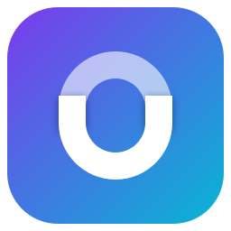

# Ostler

### The project manager that lives on your PC.

Boards, lists, timelines and calendars for Windows. No account, no tracking, no cloud you have to
trust. AI only if you want it.

[](https://github.com/AntonyWiles/ostler/releases/latest)
[](#install)
[](LICENSE)
[](#languages)

**[Download for Windows](https://github.com/AntonyWiles/ostler/releases/latest)** ·
[User guide](docs/user-guide/01-getting-started.md) · [What's new](CHANGELOG.md) ·
[Contribute](.github/CONTRIBUTING.md)

</div>

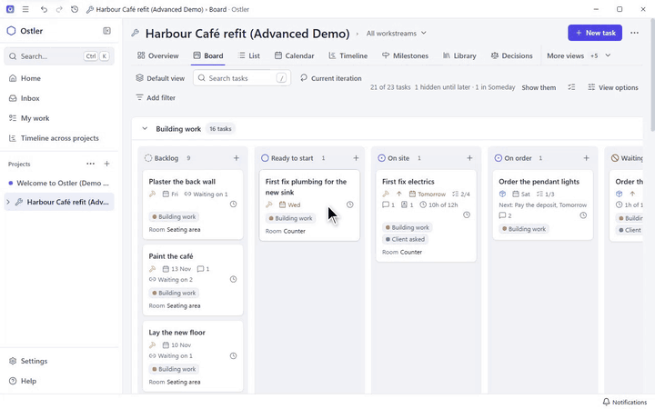

## Why Ostler

- **Nothing to sign up for.** Install it and start planning. Your projects live in a folder on your
  own computer, and there is no Ostler server.
- **Nothing phones home.** No telemetry, no crash reports, no tracking. It works fully offline.
- **For every kind of project**: a household job, a small team's backlog or a piece of software.
  The advanced parts stay out of sight until a project needs them.
- **Shared by choice.** Share a project through a folder or a sync server you run yourself, or
  export a page to send.
- **AI is optional.** Every AI feature is off until you turn it on, and it can run on a model on
  your own PC.
- **Free and open source** under the GPL-3.0, so anyone can read, check and change it.

> Ostler is in active development; see the [changelog](CHANGELOG.md) for what is new.

## One plan, every angle

Board, List, Timeline and Calendar all show the same tasks, each with filters, search and saved
views. Drag a card on the Board, stretch a bar on the Timeline or drop a task on a date, and every
view keeps up. The Overview adds reports and charts.

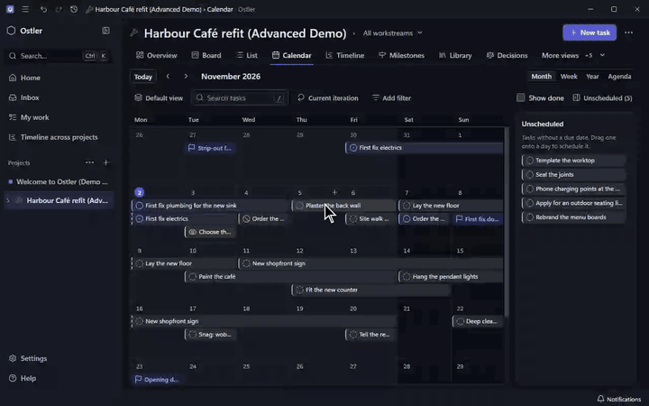

<table>
  <tr>
    <td width="50%">
      <picture>
        <source media="(prefers-color-scheme: dark)" srcset="docs/images/list-full-dark.png" />
        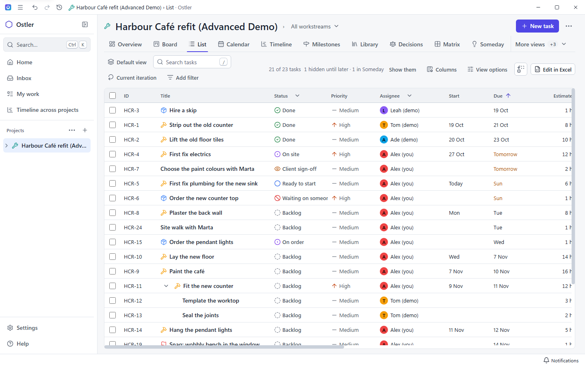
      </picture>
      <picture>
        <source media="(prefers-color-scheme: dark)" srcset="docs/images/list-dark.png" />
        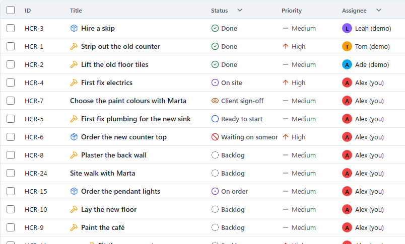
      </picture>
      <p align="center"><b>List</b></p>
    </td>
    <td width="50%">
      <picture>
        <source media="(prefers-color-scheme: dark)" srcset="docs/images/timeline-full-dark.png" />
        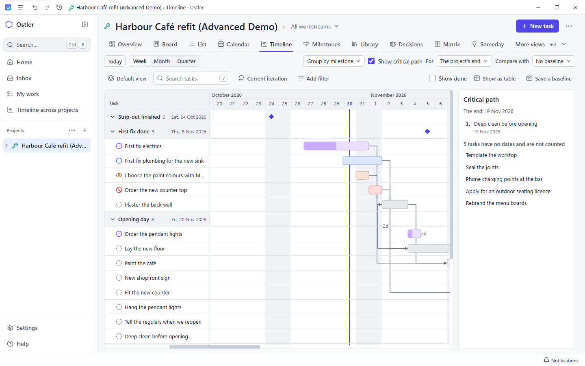
      </picture>
      <picture>
        <source media="(prefers-color-scheme: dark)" srcset="docs/images/timeline-dark.png" />
        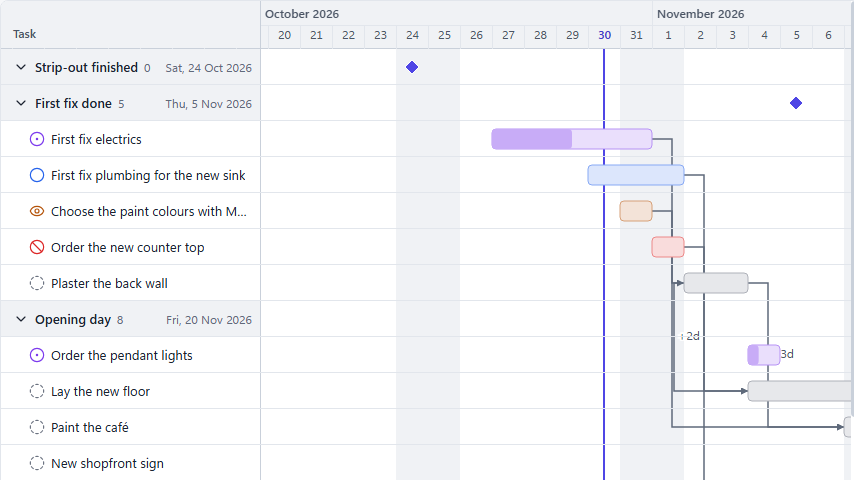
      </picture>
      <p align="center"><b>Timeline</b></p>
    </td>
  </tr>
  <tr>
    <td width="50%">
      <picture>
        <source media="(prefers-color-scheme: dark)" srcset="docs/images/calendar-full-dark.png" />
        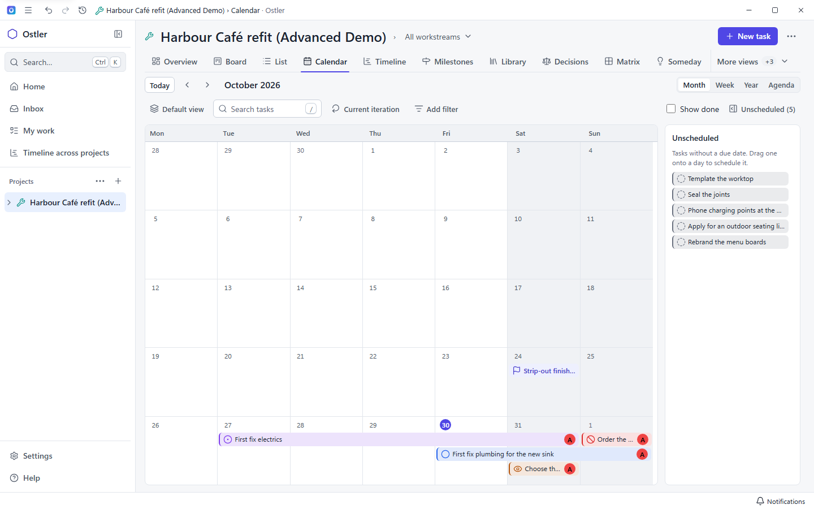
      </picture>
      <picture>
        <source media="(prefers-color-scheme: dark)" srcset="docs/images/calendar-dark.png" />
        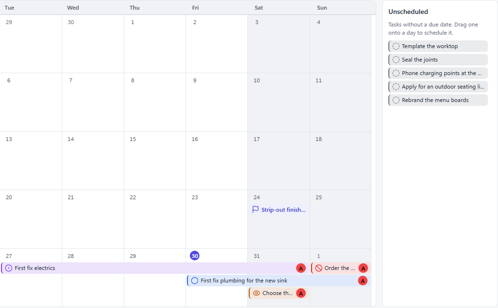
      </picture>
      <p align="center"><b>Calendar</b></p>
    </td>
    <td width="50%">
      <picture>
        <source media="(prefers-color-scheme: dark)" srcset="docs/images/overview-full-dark.png" />
        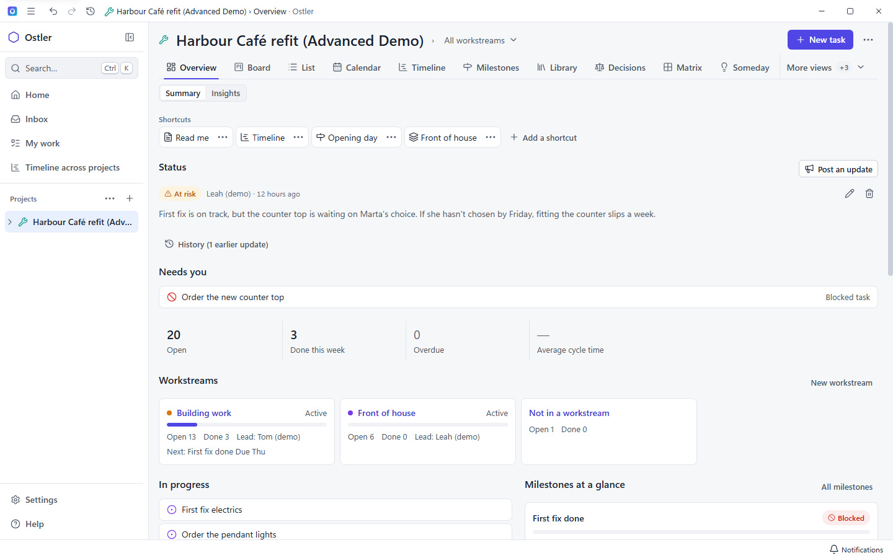
      </picture>
      <picture>
        <source media="(prefers-color-scheme: dark)" srcset="docs/images/overview-dark.png" />
        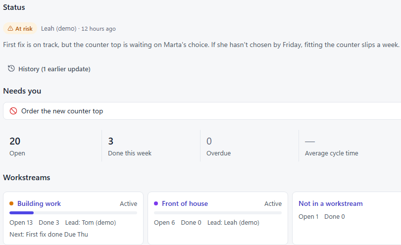
      </picture>
      <p align="center"><b>Overview</b></p>
    </td>
  </tr>
</table>

## Your day, across every project

**Home** shows what is due today and next, what is waiting on you and your reminders. **My work**
lists every task assigned to you, whichever project it is in, and **Workload** shows who has too
much on. Press `Ctrl` + `K` anywhere to find anything, or add a task in plain words such as "Order
tiles tomorrow !high".

<table>
  <tr>
    <td width="50%">
      <picture>
        <source media="(prefers-color-scheme: dark)" srcset="docs/images/home-full-dark.png" />
        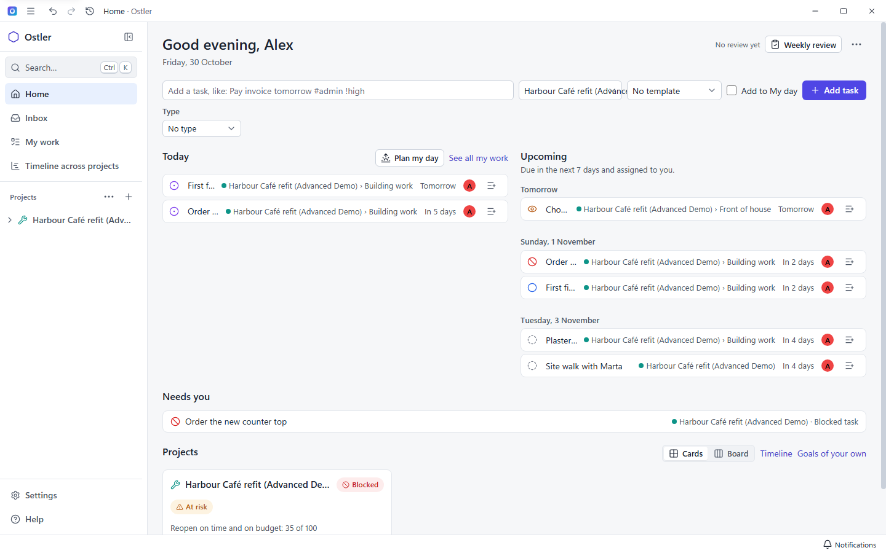
      </picture>
      <picture>
        <source media="(prefers-color-scheme: dark)" srcset="docs/images/home-dark.png" />
        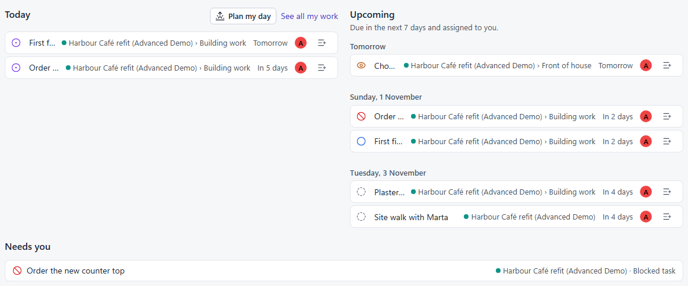
      </picture>
      <p align="center"><b>Home</b></p>
    </td>
    <td width="50%">
      <picture>
        <source media="(prefers-color-scheme: dark)" srcset="docs/images/my-work-full-dark.png" />
        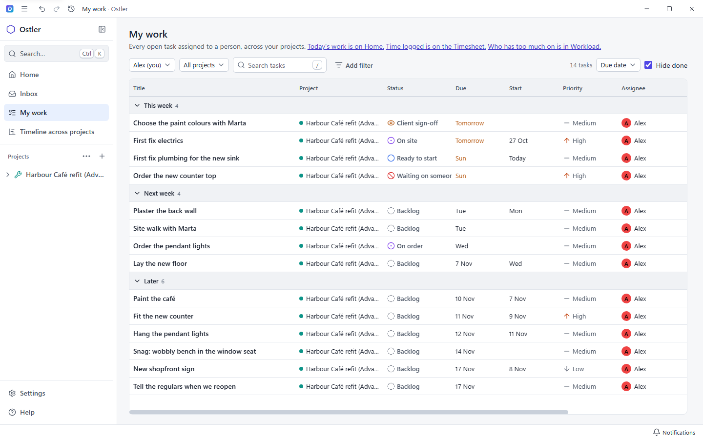
      </picture>
      <picture>
        <source media="(prefers-color-scheme: dark)" srcset="docs/images/my-work-dark.png" />
        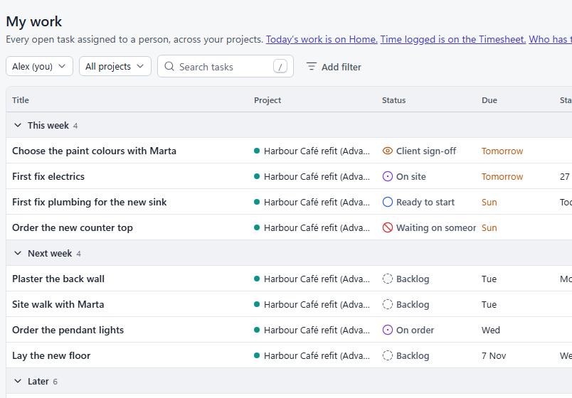
      </picture>
      <p align="center"><b>My work</b></p>
    </td>
  </tr>
</table>

## Features

### Planner, for every project

<picture>
  <source media="(prefers-color-scheme: dark)" srcset="docs/images/task-full-dark.png" />
  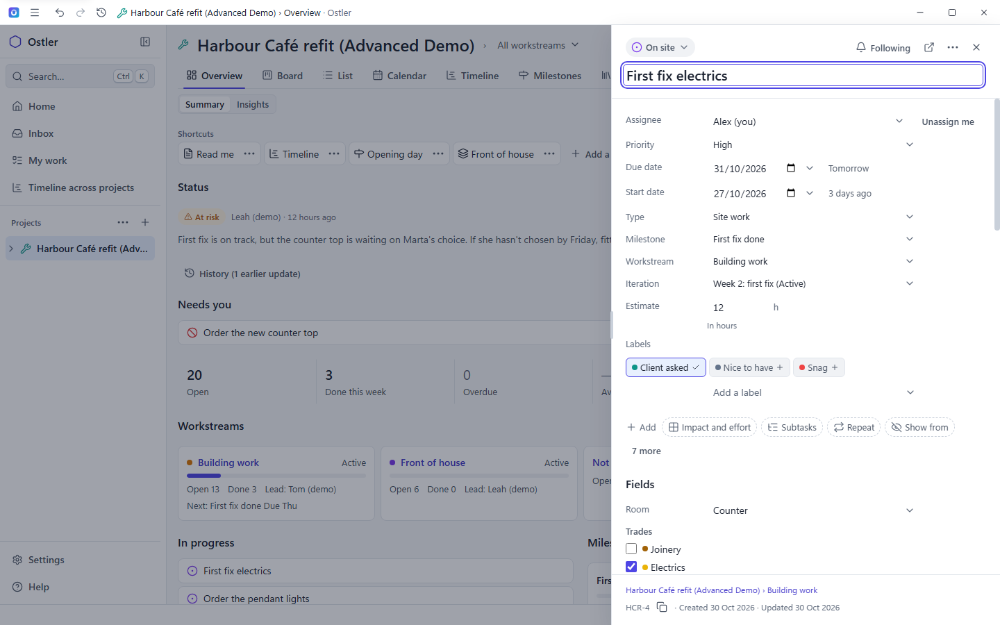
</picture>
<picture>
  <source media="(prefers-color-scheme: dark)" srcset="docs/images/task-dark.png" />
  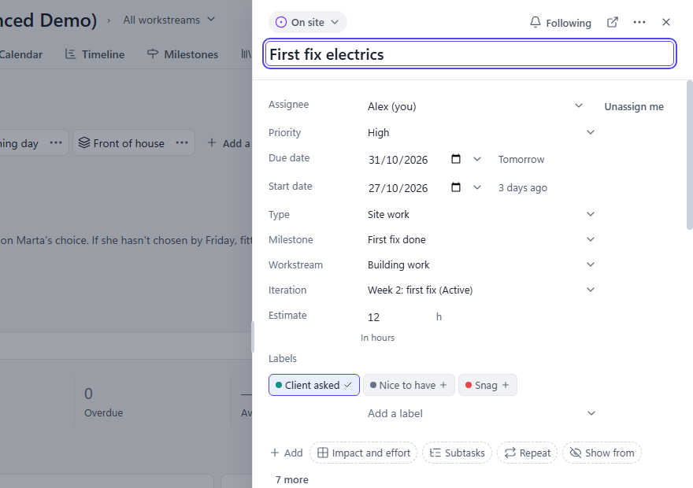
</picture>

- **Views of the same tasks**: Board, List, Calendar and Timeline, each with filters, search and
  saved views. Drag cards into your own order, and name or hide a project's columns.
- **Tasks with the details work needs**: assignees, start and due dates, priority, estimates,
  checklists, subtasks, dependencies, labels, comments and activity, plus custom fields of your
  own. The task drawer saves as you type, and the plan grid adds a whole plan at once.
- **Milestones, goals and decisions**, iterations with a burn-down, rules that act when a task
  changes, and an Overview with reports and charts.
- **Time tracking**: a timer on any task, time added by hand, and a weekly Timesheet.
- **Home and Inbox**: what is due today and next, what is waiting for you, reminders and repeating
  tasks, and quick add from anywhere (`Ctrl` + `K` finds anything). **My work** lists every task
  assigned to you across projects, and **Workload** shows who has too much on.
- **The Library**: briefs, notes, files and images kept beside the project.
- **Templates and a sample project** to start from. Import from CSV, Trello, Asana, Jira, Linear,
  Microsoft Planner, Todoist or a GitHub repository's issues; export to CSV, a project file that
  travels to another PC, a calendar file or a web page to share; print and save as PDF.
- **At home on Windows**: light, dark and system themes, a taskbar badge, notifications, a jump list,
  background mode with a Quick add key, automatic backups and restore, and full keyboard and screen
  reader support.

### Software projects

- Link a project's folder to browse its files and Git history. Ostler only reads it.
- The project keeps working without a folder; link one later.
- Link GitHub issues and pull requests to tasks, and see their state when you open the task.

### AI, optional

- **Ostler AI** suggests tasks, splits goals into steps and summarises a project. Use a hosted
  provider with your own key, or a model on your PC such as Ollama or LM Studio. It only ever
  suggests: nothing is added until you choose to add it. **Ostler doesn't include or provide an AI
  model:** Ostler AI sends your request to the model you connect. A provider's service handles what
  you send under its own terms and privacy policy, not Ostler's, so read that policy before you
  connect it. A model on your PC sends nothing anywhere.
- **AI coding agents** (off for new installs; Settings › Agents) take tasks from a software project
  and each work in their own copy of the project. You review their work and apply it, send it back
  or discard it, and History undoes anything you applied. Agents can be built-in (OpenCode, shipped with Ostler) or any external CLI
  agent through a local API. Choose the model for each run, send guidance while it works, and see
  each run's history, usage and limits.
- **Connect an AI assistant** over MCP (Model Context Protocol) to read and plan a project through
  the automation API.

## Languages

Ostler's interface is in English and seven other languages: German (`de`), French (`fr`), Spanish
(`es`), Italian (`it`), Brazilian Portuguese (`pt-BR`), Japanese (`ja`) and Simplified Chinese
(`zh-Hans`). The seven are machine translations from English, and corrections are welcome (see
[Translating Ostler](docs/translating.md)). Ostler follows your Windows display language; choose
another in Settings › General › Language. Dates and numbers follow your Windows region. The user
guide stays in English, and Quick add understands English words only, such as "tomorrow" and "!high".

## On your phone

Ostler for Android shows your projects and My Day and lets you change tasks from your pocket. It
syncs through your own Google Drive, encrypted, so there is still no Ostler server and nothing is
sent to us. Pair the phone with your PC or join a project shared through Drive; the
[guide](docs/user-guide/32-ostler-on-your-phone.md) has the steps. It is Android only, given to
testers through Google Play, and in Google's testing mode sign-in lasts 7 days. The phone cannot mark
a repeating task done, and your personal data is read-only there. Release steps are in
[docs/mobile/releasing.md](docs/mobile/releasing.md).

## Install

Ostler runs on Windows 10 22H2 and Windows 11, x64.

1. Download `Ostler-Setup-<version>.exe` from the
   [latest release](https://github.com/AntonyWiles/ostler/releases/latest).
2. Run it. The installer is per-user and needs no administrator rights.

**While the installer is unsigned**, Windows SmartScreen shows "Windows protected your PC". Choose
**More info** › **Run anyway**. The warning goes once the download has a reputation, or once
releases are signed.

The installed Ostler checks GitHub for updates when it starts, downloads them in the background and
installs them when you restart. Turn either off in Settings › About. Uninstalling keeps your data
unless you tick the box to remove it.

New to Ostler? The [user guide](docs/user-guide/01-getting-started.md) starts here, and the same guide
is in the app under **Help**.

## Build from source

You need Windows 10 or 11 (x64), [Node.js 22](https://nodejs.org/) with npm, and
[Git](https://git-scm.com/). `better-sqlite3` is a native module: npm downloads a prebuilt binary
for it, so no compiler is needed in the usual case. If none matches, install the Visual Studio Build
Tools with the "Desktop development with C++" workload.

```powershell
git clone https://github.com/AntonyWiles/ostler.git
cd ostler
npm ci
npx install-electron     # Electron 43 downloads its binary only when asked
npm run rebuild:native   # builds better-sqlite3 for Electron

# Keep development data away from a real install: any empty folder outside the repository.
$env:OSTLER_USER_DATA = "$env:TEMP\ostler-dev-data"
npm run dev
```

To build the installer: `npm run package:win` (output in `dist/ostler/`). For a portable `.exe`
that needs no installation: `npm run package:portable`. To run the whole
quality gate: `npm run verify`. [CONTRIBUTING.md](.github/CONTRIBUTING.md) explains the native-module
rebuild, every test suite and how changes are reviewed.

## Privacy

Your projects stay on your computer, in `%APPDATA%\ostler`. There is no account, no server and
no telemetry. Nothing leaves your PC unless you connect an account, share a project, subscribe to
a calendar link or turn on AI, and then only what that feature needs, to the place you chose.

<details>
<summary><b>Exactly what Ostler sends, and when</b></summary>

- **Your data stays on this computer**, in Ostler's data folder (`%APPDATA%\ostler` for an
  installed Ostler). There is no account and no server.
- **No telemetry.** Ostler sends no usage data and no crash reports. Errors go to a log file on your
  PC; **Help** › **Copy diagnostics** copies a redacted report for you to share if you choose.
- **Contacts stay on this PC.** **Call** and **Email** only hand Windows a `tel:` or `mailto:`
  address; contacts are never written to the log, Copy diagnostics or the shareable report.
- **Calendar files you add are read, not followed.** Ostler reads an `.ics` file only when you add
  or reload it, and fetches nothing it names.
- **A calendar link you subscribe to is fetched, and nothing else is sent.** Ostler fetches exactly
  that `https` address when you add it, a minute after it starts, hourly while it runs and on
  **Refresh**, with no cookies or sign-in, and stores the link encrypted. Nothing is fetched until
  you add a link.
- **Your folders are read, not changed.** Ostler writes to a project folder only when you ask it to
  create a new one, or when you apply, undo or restore an AI agent's work. It saves your own edits
  first and never pushes.
- **Ostler doesn't include or provide an AI model.** Ostler AI is the name for Ostler's AI
  features: they send your request to the AI model you connect, either a provider's service with
  your own API key or a model running on your PC. When you use a provider's service, what you send
  is handled under that provider's terms and privacy policy, not Ostler's: Ostler can't see or
  control what happens to it once it's sent. Read your provider's privacy policy before you connect
  it. A model running on your PC sends nothing anywhere.
- **Ostler AI sends nothing until you set it up and use it.** It may read everything Ostler holds,
  contacts, costs, budgets, billable time and rates, calendar events, your own goals and field
  values included, but each request sends the provider you configured, and only it, what that
  feature needs: the request's own records and your chat messages, the project's Library items set
  to **Always** and the **When selected** ones you choose or attach, the project files it reads,
  and contacts, costs and the rest only when a feature needs them. A Library item set to **Human
  only** is never sent. Ostler AI never writes: it suggests, and anything saved is your own click.
  A local model sends nothing off your PC. Home's **Write it up**
  sends only task titles and counts, when you press it; **Listen** uses a Windows voice and sends
  nothing. **Find tasks** sends only the text you gave it and any photo you added (scaled down,
  without its location data), when you press it. **Find actions and decisions** sends only that
  Library note's title and text, never a note set to Never. **Ask Ostler** sends your question and
  the date, then your question with the records, contacts and file passages Ostler's own search
  found on your PC, when you press **Ask**; a follow-up also sends that conversation's earlier
  questions and answers. **Describe it** in a filter bar sends only your words, today's date and
  the project's names (statuses, labels, milestones, goals, iterations, people and contacts), never
  a task. **Improve writing** sends only the text you chose, its style and the project's name; **Summarise** on a
  task sends that task's title and comments, with their authors' names and dates; **Polish with
  AI** on release notes sends only the draft (names, task titles and the first sentences you chose);
  **Draft from activity** on a status update sends the project's recent activity, as the activity
  list words it, and its open milestones' progress. **Fill with AI** on an AI field sends, per
  task, only the field's name, instruction and options and the task's title, description and
  checklist, when you press it, never on its own.
- **AI coding agents** send their task, and the code they read in their copy, to the model
  provider you configure for them, under that provider's terms and privacy policy. OpenCode ships
  with Ostler but is an agent program, not a model. Their local APIs listen only on `127.0.0.1`, only while agents
  are on, and need a token.
- **An AI assistant you connect** over MCP (Settings › Connections) reads and changes a project
  through the automation API, which listens only on `127.0.0.1`, only while you turn it on, and
  needs that project's token. The assistant may send what it reads to its own AI provider; Ostler
  sends nothing itself.
- **Keys and tokens** (AI keys, the GitHub token, and each project's automation token)
  are encrypted with Windows' own protection (`safeStorage`) and never shown again after you enter
  them. If Windows cannot encrypt them, they are stored in plain text and encrypted on the next
  start where Windows can.
- **GitHub links and imports** ask `api.github.com` about an issue or pull request only when you
  open a task that links one, press Refresh, link one or import a repository's issues. They send the
  repository, the issue number or import filters, and your GitHub token if you saved one. Nothing
  is fetched in the background and nothing is written to GitHub.
- **Files you export** (a project file, CSV, PDF, calendar file or web page) hold what you chose
  to put in them and go wherever you save or send them. Ostler uploads none of them. A calendar file
  is a copy, not a live feed, and a shared web page makes no requests of its own.
- **Updates** ask GitHub's release feed whether there is a new version. Nothing about you or your
  data is sent. A portable Ostler you build yourself never checks.

</details>

The [privacy page](docs/user-guide/18-privacy.md) of the user guide says the same in more detail.

## Licence and links

Copyright (c) 2026 Antony Wiles. Ostler is released under the
[GNU General Public License, version 3](LICENSE) (GPL-3.0-only). If you give other people a copy of
Ostler, changed or not, you must offer them its source under the same licence. The open
source packages it ships are listed with their licences in the app under Settings › About › Open
source licences.

- [User guide](docs/user-guide/01-getting-started.md) · [Changelog](CHANGELOG.md)
- [Contributing](.github/CONTRIBUTING.md) · [Translating Ostler](docs/translating.md) ·
  [Architecture](docs/architecture.md)
- [Report a bug or ask for a feature](https://github.com/AntonyWiles/ostler/issues/new/choose)
  · [Report a security issue](.github/SECURITY.md)
- [Automation API](docs/automation-api/README.md) for scripts and agents that drive Ostler
- [Releasing](docs/releasing.md) for maintainers
